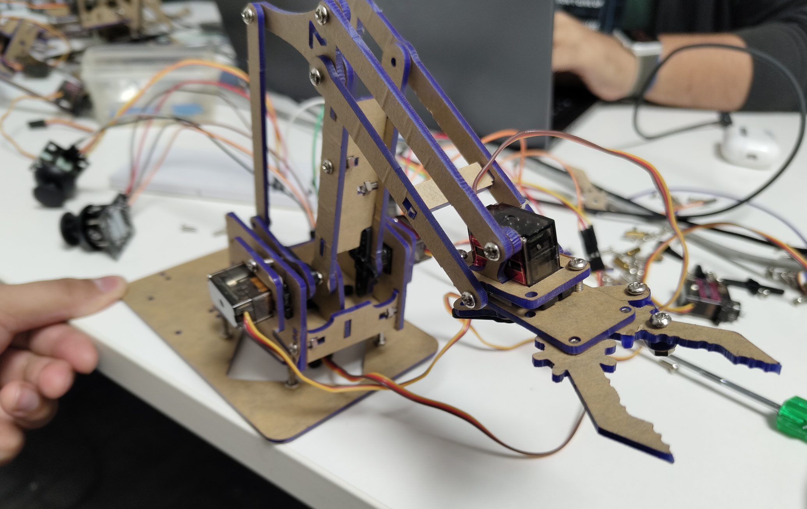
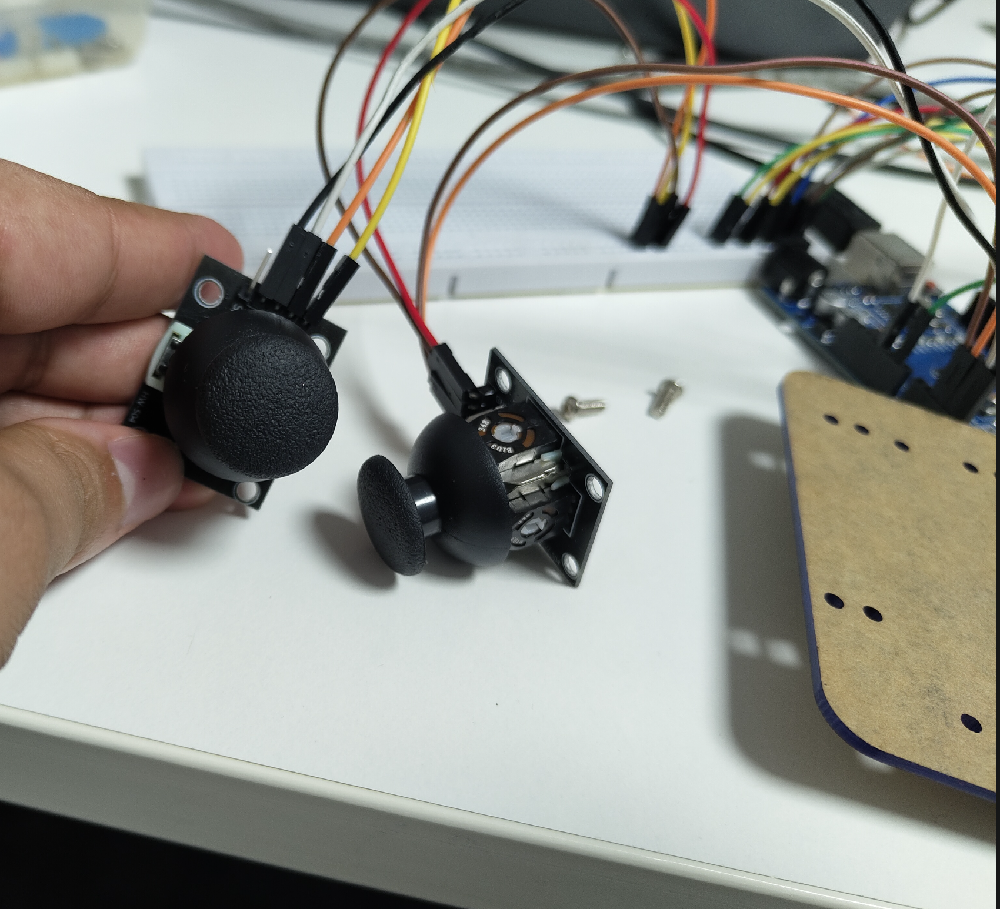
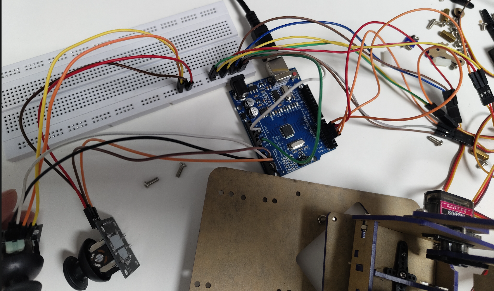
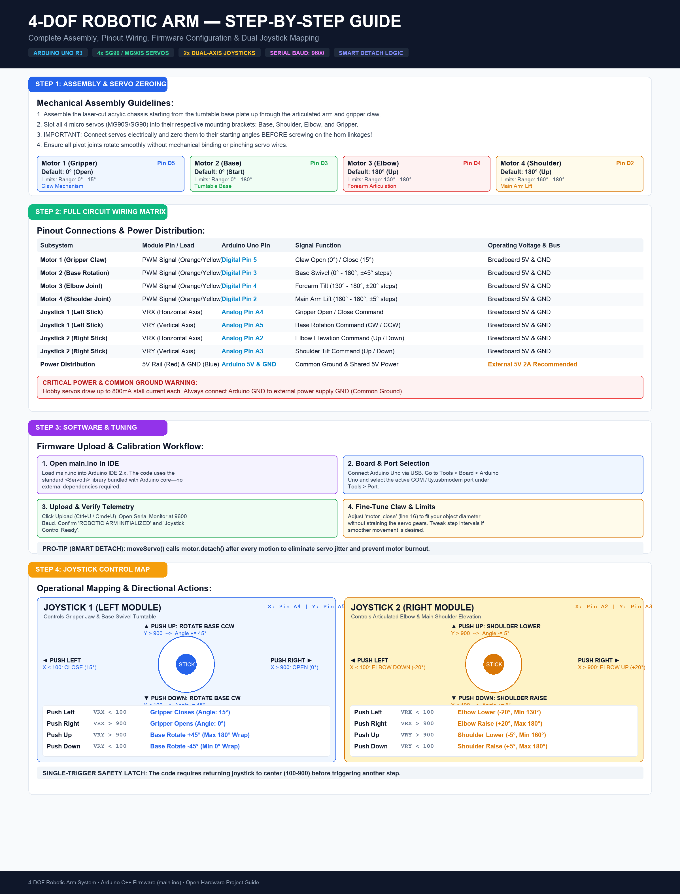

# 🤖 4-DOF Robotic Arm with Dual Joystick Control

An Arduino-powered 4-Degree-of-Freedom (4-DOF) articulated robotic arm controlled intuitively using two dual-axis analog joysticks. Built with laser-cut acrylic mechanics, four micro-servo motors (SG90 / MG90S), and an Arduino Uno running smart anti-jitter firmware.

---

## 📸 Visual Showcase & Step-by-Step Guide

### 1. Fully Assembled Robotic Arm


### 2. Dual-Axis Joystick Controllers


### 3. Circuit & Breadboard Wiring Setup


### 4. Comprehensive Step-by-Step Infographic Guide


---

## 📋 Table of Contents
- [Hardware Overview](#-hardware-overview)
- [Complete Wiring Matrix & Pinout](#-complete-wiring-matrix--pinout)
- [Firmware Deep-Dive (`main.ino`)](#-firmware-deep-dive-mainino)
- [Dual Joystick Control Scheme](#-dual-joystick-control-scheme)
- [Step-by-Step Setup Guide](#-step-by-step-setup-guide)
- [Calibration & Tuning](#-calibration--tuning)
- [Troubleshooting & Pro Tips](#-troubleshooting--pro-tips)

---

## 🛠 Hardware Overview

| Component | Quantity | Purpose |
| :--- | :---: | :--- |
| **Arduino Uno R3** | 1 | Microcontroller running `main.ino` firmware |
| **Micro Servos (SG90 / MG90S)** | 4 | Actuators for Base, Shoulder, Elbow, and Gripper |
| **Dual-Axis Joysticks (HW-504 / KY-023)** | 2 | Analog input modules for user control |
| **Laser-cut Chassis (Acrylic / MDF)** | 1 | 4-DOF mechanical arm frame and claw mechanism |
| **Half / Full Breadboard** | 1 | 5V and GND power rail distribution |
| **Jumper Wires (M-M, M-F)** | Set | Circuit interconnects |
| **Power Supply (5V 2A-3A)** | 1 | Dedicated external servo power (recommended) |
| **USB Type-B Cable** | 1 | Arduino programming and Serial monitor telemetry |

---

## 🔌 Complete Wiring Matrix & Pinout

All 4 servos and both joystick modules share a common 5V power bus and ground bus via the breadboard.

### Servo Connections
| Motor | Joint / Function | Servo Signal (Orange/Yellow) | Servo VCC (Red) | Servo GND (Brown) |
| :--- | :--- | :---: | :---: | :---: |
| **Motor 1** | **Gripper Claw** | **Digital Pin 5** | Breadboard +5V | Breadboard GND |
| **Motor 2** | **Base Turntable** | **Digital Pin 3** | Breadboard +5V | Breadboard GND |
| **Motor 3** | **Elbow Joint** | **Digital Pin 4** | Breadboard +5V | Breadboard GND |
| **Motor 4** | **Shoulder Joint** | **Digital Pin 2** | Breadboard +5V | Breadboard GND |

### Joystick Connections
| Module | Axis / Pin | Arduino Pin | Controlled Joint | Trigger Values |
| :--- | :--- | :---: | :--- | :--- |
| **Joystick 1 (Left)** | **VRX (X-Axis)** | **Analog A4** | **Gripper (Open / Close)** | `< 100` (Close), `> 900` (Open) |
| **Joystick 1 (Left)** | **VRY (Y-Axis)** | **Analog A5** | **Base Rotation (CW / CCW)** | `< 100` (-45°), `> 900` (+45°) |
| **Joystick 1 (Left)** | **VCC / GND** | 5V / GND | Power Rails | Breadboard Bus |
| **Joystick 2 (Right)** | **VRX (X-Axis)** | **Analog A2** | **Elbow Joint (Up / Down)** | `< 100` (-20°), `> 900` (+20°) |
| **Joystick 2 (Right)** | **VRY (Y-Axis)** | **Analog A3** | **Shoulder Joint (Tilt)** | `< 100` (+5°), `> 900` (-5°) |
| **Joystick 2 (Right)** | **VCC / GND** | 5V / GND | Power Rails | Breadboard Bus |

> [!IMPORTANT]
> **Common Ground Rule**: Always connect the Arduino's `GND` pin to the breadboard's ground rail. If using an external 5V power supply for the servos, its negative terminal **must** also be tied to Arduino GND.

---

## 🧠 Firmware Deep-Dive (`main.ino`)

The firmware located at [`main.ino`](file:///Users/pranav/PRNV/RoboticArm/main.ino) implements several smart robotics concepts:

### 1. Smart Dynamic Attach / Detach Pattern
Standard servo libraries hold their PWM signal continuously, causing micro-servos (like SG90) to vibrate, hum, overheat, and draw excessive idle current. The code mitigates this with a dynamic helper:

```cpp
void moveServo(Servo &motor, int pin, int angle, int waitTime) {
  motor.attach(pin);   // 1. Attach PWM signal to pin
  motor.write(angle);  // 2. Command servo to target angle
  delay(waitTime);     // 3. Wait for arm link to physically reach position
  motor.detach();      // 4. Detach PWM to silence motor & prevent jitter
}
```

### 2. Single-Trigger Latching (Anti-Repeat)
Holding an analog joystick in a tilted position can unintentionally send dozens of rapid-fire increment commands. To make control deliberate and stepped, the firmware uses boolean latching flags:
- `grip_ready`, `base_ready`, `elbow_ready`, `shoulder_ready`

When an axis exceeds `joystick_high` (900) or drops below `joystick_low` (100), the movement executes once and sets its flag to `false`. The user **must return the joystick to center (between 100 and 900)** to reset the flag to `true` before another step can be triggered.

### 3. Axis Configuration & Safety Constraints
Each joint has strictly defined minimums, maximums, and increment steps to prevent mechanical binding:

| Joint | Object | Pin | Default Angle | Range Limits | Step Size | Motion Behavior |
| :--- | :---: | :---: | :---: | :---: | :---: | :--- |
| **Gripper** | `motor1` | Pin 5 | `0°` (Open) | `0°` – `15°` | Direct | Toggle open (0°) or closed (15°) |
| **Base** | `motor2` | Pin 3 | `0°` | `0°` – `180°` | `45°` | Wraps around when exceeding 180° or dropping below 0° |
| **Elbow** | `motor3` | Pin 4 | `180°` | `130°` – `180°` | `20°` | Constrained bounds, prevents forearm over-extension |
| **Shoulder**| `motor4` | Pin 2 | `180°` | `160°` – `180°` | `5°` | Fine 5° increments for smooth arm elevation |

### 4. Serial Diagnostics & Telemetry
The firmware initializes the serial port at **9600 baud** in `setup()`.
- Every servo move outputs its current target angle (e.g., `Base Angle: 90`, `Elbow Angle: 140`, `GRIPPER: OPENING`).
- For hardware debugging, the built-in function `joystickprint()` can be uncommented in `loop()` to monitor real-time raw ADC values across all 4 axes (`A2`, `A3`, `A4`, `A5`).

---

## 🕹 Dual Joystick Control Scheme

```
  +-------------------------------------+   +-------------------------------------+
  |          JOYSTICK 1 (LEFT)          |   |         JOYSTICK 2 (RIGHT)          |
  |    Base Rotation & Gripper Claw     |   |       Elbow & Shoulder Joints       |
  +-------------------------------------+   +-------------------------------------+
                   ▲                                         ▲
         PUSH UP: Rotate Base CCW                  PUSH UP: Shoulder Forward/Down
          (VRY > 900: Angle += 45°)                 (VRY > 900: Angle -= 5°)
                   │                                         │
  ◄ PUSH LEFT      ┼      PUSH RIGHT ►      ◄ PUSH LEFT      ┼      PUSH RIGHT ►
  Close Gripper    │      Open Gripper      Elbow Forward    │      Elbow Backward
   (VRX < 100)     │       (VRX > 900)       (VRX < 100)     │       (VRX > 900)
  Angle: 15°       │      Angle: 0°         Angle -= 20°     │      Angle += 20°
                   │                                         │
                   ▼                                         ▼
        PUSH DOWN: Rotate Base CW                  PUSH DOWN: Shoulder Backward/Up
          (VRY < 100: Angle -= 45°)                 (VRY < 100: Angle += 5°)
```

---

## 🚀 Step-by-Step Setup Guide

### Step 1: Mechanical Assembly & Pre-Zeroing
1. Assemble the laser-cut arm brackets according to your kit's mechanical blueprint.
2. **Before screwing the servo horns onto the motor splines:**
   - Flash `main.ino` onto the Arduino.
   - Connect the servos to their respective signal pins.
   - Power up the Arduino so all 4 servos travel to their default initialization angles:
     - Gripper: **0°**
     - Base: **0°**
     - Elbow: **180°**
     - Shoulder: **180°**
3. Once the servos have settled at these angles, attach the mechanical horns and linkages in their natural resting positions. This prevents mechanical strain and stripped gears.

### Step 2: Breadboard & Circuit Wiring
1. Route Arduino **5V** and **GND** to the breadboard side rails.
2. Plug both Joystick modules into the breadboard.
3. Wire Joystick 1 (Left) pins `VRX -> A4`, `VRY -> A5`, `+5V`, and `GND`.
4. Wire Joystick 2 (Right) pins `VRX -> A2`, `VRY -> A3`, `+5V`, and `GND`.
5. Connect Servo signal lines to Arduino digital pins:
   - Motor 1 (Gripper): **D5**
   - Motor 2 (Base): **D3**
   - Motor 3 (Elbow): **D4**
   - Motor 4 (Shoulder): **D2**
6. Connect all Servo red wires to `+5V` and brown/black wires to `GND`.

### Step 3: Software & Upload
1. Launch the **Arduino IDE** (version 1.8+ or 2.x).
2. Open [`main.ino`](file:///Users/pranav/PRNV/RoboticArm/main.ino).
3. Connect the Arduino Uno to your computer with the USB cable.
4. Go to **Tools > Board > Arduino AVR Boards > Arduino Uno**.
5. Select your Arduino's serial port under **Tools > Port**.
6. Click **Upload** (`Ctrl+U` or `Cmd+U`).
7. Open the **Serial Monitor** at **9600 Baud** to verify initialization.

---

## ⚙️ Calibration & Tuning

In [`main.ino`](file:///Users/pranav/PRNV/RoboticArm/main.ino), you can easily modify key variables to customize arm behavior:

1. **Claw Grip Tightness**:
   - Line 16: `int motor_close = 15;`
   - If the claw does not close enough to hold objects, increase to `25` or `30`.
   - If the servo strains or clicks when gripping, decrease this angle.
2. **Base Rotation Speed**:
   - Line 31: `int base_step = 45;`
   - Change to `15` or `30` for finer, more precise base positioning.
3. **Shoulder Range & Step**:
   - Lines 39-41:
     ```cpp
     int shoulder_min = 160;
     int shoulder_max = 180;
     int shoulder_step = 5;
     ```
   - Expand `shoulder_min` downwards (e.g., to `140`) if you need the arm to reach further forward.
4. **Deadzone Thresholds**:
   - Lines 46-47:
     ```cpp
     const int joystick_high = 900;
     const int joystick_low = 100;
     ```
   - If your joysticks trigger accidentally when released, tighten the thresholds (e.g., `950` and `50`).

---

## 💡 Troubleshooting & Pro Tips

- **Problem: Arduino resets when moving multiple servos**
  - *Cause:* Servos draw high inrush currents (up to 800mA each) which causes a brownout reset on the Arduino 5V regulator.
  - *Solution:* Power the breadboard 5V rail using an external 5V 2A–3A DC power adapter. Make sure to share ground with the Arduino.
- **Problem: Servos buzz or get hot while idle**
  - *Cause:* Servos attempting to hold position under load or receiving noisy PWM signals.
  - *Solution:* The code already utilizes `motor.detach()` after each movement in `moveServo()`. Ensure wait delays (`500ms` / `700ms`) are sufficient for full travel before detachment.
- **Problem: Gripper or joints move in reverse**
  - *Cause:* Inverted potentiometer orientation on the joystick or mirrored mechanical linkage.
  - *Solution:* In `loop()`, simply swap the conditions (e.g., swap `hand_open()` and `hand_close()` for `joystick1x`).

---

## 📜 File Structure
```
RoboticArm/
├── main.ino                    # Arduino C++ control firmware
├── robotic_arm_assembled.png   # Photo of assembled 4-DOF robotic arm
├── joystick_modules.png        # Photo of dual HW-504 joystick controllers
├── arduino_circuit_setup.png   # Photo of Arduino Uno & breadboard wiring
├── step_by_step_guide.png      # Generated high-res visual wiring & control guide
└── README.md                   # Complete documentation and setup guide
```
